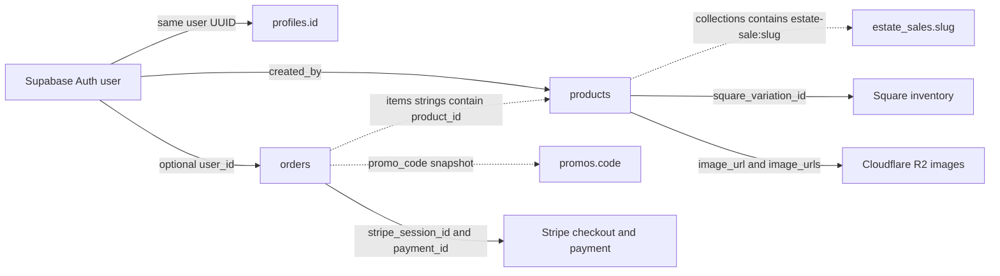

**Thrift Barn database reference — inspected 2026-10-29**

This reference combines the configured Supabase REST schema, aggregate inspection of every currently exposed application table, and the repository's database access code. The inspection used GET and HEAD only. No database records, payments, accounts, or policies were changed. Customer details and credentials are not included in the artifacts.

The exact exposed column definitions, required fields, defaults, primary keys, enum values, and RPC parameter definitions are in [database-snapshot.json](database-snapshot.json). This is a non-transactional snapshot of the database configured in `.env.local`; deployment environment equivalence was not established.

| Table | Primary key | Rows | Purpose |
| --- | --- | ---: | --- |
| products | id, UUID | 9 | Catalog, stock, categorization, price programs, image references, Square identifiers |
| profiles | id, UUID | 7 | Customer contact details and administrator flag; 3 profiles are administrators |
| orders | order_id, UUID | 1 | Checkout snapshots, customer/shipping details, payment linkage and fulfillment state |
| promos | id, UUID | 0 | Percentage or fixed-amount discounts with activation windows |
| estate_sales | slug, text | 1 | Estate collection names and cover photos |

Eight products are active; all nine have Square variation IDs. The only order is a fulfilled website guest order, denominated in CAD. No products currently use either scheduled pricing program or the unlimited-stock sentinel.

**Relationships and storage conventions**

The following diagram shows relationships used by application code, not verified foreign-key constraints. The REST schema does not establish their constraint definitions or delete behavior.

Products store category, subcategory, room tags, collections, colors, and image galleries as text arrays. There are no separately exposed category or order-item tables. `initial_price` is set on creation and preserved by the product edit route; `price` is the current price in dollars. Product dimensions are displayed in inches.

`quantity` is a required integer. Application code interprets quantities of 1,000,000 or greater as unlimited, and stores unlimited inventory as 999,999,999. Its UI representation is null. Finite products generally set `is_active` according to whether quantity is positive. This overloaded representation matters when syncing with Square.

`orders.items` is **text[]**, not JSONB. The current record contains a JSON-encoded string per item with keys `product_id`, `quantity`, `unit_price_cents`, and `name`. The checkout code builds object arrays and the readers tolerate strings and objects; comments describing the database column as JSONB are inaccurate. There is no verified database-level validation of the embedded item shape or product references.

Product prices and order subtotal/tax/total/shipping/promo columns are decimal dollar amounts. Item `unit_price_cents` and order `amount_total_cents` use integer cents. `channel` is the enum `website | app | pos`. `status` is text, with pending, paid, fulfilled, refunded, and chargeback handled in code; a database check constraint has not been verified.

Profiles have full_name, phone, address, and is_admin. Email comes from Supabase Auth rather than a profile email column. Addresses are merged text strings, then split on commas for checkout prefill. Registration supplies user metadata but does not explicitly insert a profile; the account-creation mechanism needs trigger inspection.

Estate membership is encoded in product `collections` as `estate-sale:<slug>`. The metadata table holds the display name and photo. Legacy `estate-sale-photo:` tags are supported in helpers. The homepage component reads estate metadata; the product admin endpoint also reads it. Relationships are maintained in code rather than a scalar estate foreign key.

**Application flows**

| Flow | Main implementation | Database behavior |
| --- | --- | --- |
| Catalog browsing | ../lib/products.ts | Reads active products and normalizes quantity |
| Product create/edit | ../app/api/admin/products/route.ts | Checks admin, uploads R2 images, saves product, attempts Square sync, optionally mirrors to Cloudflare |
| Product deletion | ../app/api/admin/products/[id]/route.ts | Deletes Square objects, then R2 images, then the product row |
| Checkout creation | ../app/api/stripe/checkout/route.ts | Revalidates prices/stock/promos, inserts pending order, creates Stripe session, saves session ID |
| Payment completion | ../lib/stripe-fullfillment.ts | Reads current products, updates pending order to paid, updates product stock, attempts Square sync |
| Customer order history | ../app/account/orders/page.tsx | Filters orders by authenticated user_id |
| Guest receipt | ../app/api/orders/by-session/route.ts | Reads order with service credentials using caller-supplied Stripe session ID |
| Fulfill/refund | ../app/api/admin/orders/[orderId]/ | Requires admin and updates lifecycle state; refund calls Stripe; no stock restoration in refund route |
| Square inventory webhook | ../app/api/square/webhook/route.ts | Verifies signature and overwrites stock by Square variation ID |
| Profile edits | ../app/account/profile/ProfileForm.tsx | Browser updates full_name, phone, address for the user's UUID |
| Account deletion | ../app/api/account/delete/route.ts | Deletes profile then Auth user; profile delete error is not checked |

The cart is localStorage-backed rather than database-backed. Service requests are emailed through Brevo SMTP and are not stored in an exposed application table. `inventory_events` appears only in commented code. Optional Cloudflare mirroring is disabled in the inspected local environment because the endpoint variable is absent; deployment configuration was not checked.

The source also reads database tables in homepage components such as `components/home/EstateSaleSection.tsx`, `components/home/BarnBurnerSection.tsx`, and `components/navbar/navbar.tsx`.

**Database functions and pricing**

The service-role OpenAPI document exposes `is_admin(uid uuid)`, `current_role()`, `tick_price_programs()`, `decrement_product_quantity(p_id uuid, p_amount integer)`, and `finalize_order(p_order_id uuid, p_stripe_session_id text, p_payment_intent text, p_amount_total_cents integer, p_currency text, p_customer_email text)`.

No active `.rpc(...)` calls were found in the app. Function names suggest intended roles, but do not establish their actual behavior, atomicity, or privilege checks. None was executed during inspection. Product administration sets program start dates and tick markers and comments refer to database cron. Cron configuration and function bodies remain unverified. Every edit resets enabled program start/tick fields, rather than checking whether the program was just enabled.

**Observed integrity and access**

The checked records had no negative stock or price, active products without stock, duplicate SKUs or Square variation IDs, missing product images, unresolved estate references, malformed item JSON, missing referenced products, or order arithmetic mismatches. This small dataset does not exercise concurrency, refunds, promos, or pricing jobs.

Anonymous HEAD requests returned 8 product rows and 1 estate row, and zero order/profile rows. Promotions were empty for both roles, so that result cannot establish their access policy. Anonymous schema discovery returned 401. That does not establish whether individual RPCs are executable. Authenticated customer/admin policies, column permissions on `profiles.is_admin`, and all write permissions remain untested.

**Key failure modes to preserve in future work**

1. Payment and inventory updates are separate requests. The order is marked paid before stock updates finish. Retrying after a stock failure can stop at the already-paid guard and leave stock or notifications incomplete.
2. Stock is read, subtracted in JavaScript, then written without an expected-quantity condition. Two orders or concurrent Square updates can overwrite one another. Checkout does not reserve finite stock before payment.
3. Payment completion reconstructs item names/prices from current products, replacing the pending snapshot. A price change during checkout can change recorded subtotal and inferred tax even though Stripe charged the original amount.
4. Square row errors are logged while the webhook still returns success; old inventory counts have no timestamp ordering check in the route.
5. Product deletion and multi-system writes are not transactional across Supabase, R2, and Square. Partial failures can leave dangling assets or inconsistent catalogs.
6. Guest receipt endpoints use session ID possession as the access credential and return customer contact/address data. Database RLS does not protect this service-role application route.
7. Refund code does not restore inventory, and refund success followed by database failure is not handled by a durable reconciliation mechanism in this repository.

Further verified findings and priorities are in [site-review.md](site-review.md).

**Remaining visibility gap**

There are no repository schema migrations or generated database types. REST metadata cannot prove foreign keys, uniqueness/check constraints, indexes, RLS policy text, trigger behavior, function bodies, cron schedules, backup configuration, or query plans. [database-internals.sql](database-internals.sql) contains read-only catalog queries to inspect those with an appropriate PostgreSQL connection. It has been prepared but not executed.

To refresh exposed schema and aggregate checks from the repository root, run `node docs/inspect-database.mjs` with network access and the existing local environment configuration. This updates the snapshot and prints aggregates only.
